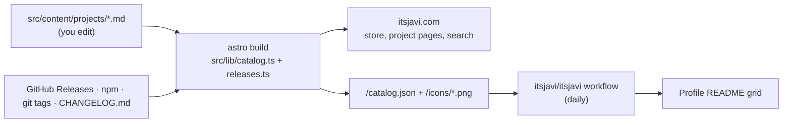

# itsjavi.com

Source of [itsjavi.com](https://itsjavi.com): a store-style catalog of my apps and libraries, a blog, and a few CSS
experiments. It is a static Astro site deployed to GitHub Pages, and it also feeds the project grid of my
[GitHub profile README](https://github.com/itsjavi/itsjavi).

- [How it works](#how-it-works)
- [Common tasks](#common-tasks): add, update, retire or remove a project; write a post; add an experiment
- [Project file reference](#project-file-reference)
- [Versions, release notes and the featured cards](#versions-release-notes-and-the-featured-cards)
- [Code map](#code-map)
- [Development](#development)
- [Deployment and automation](#deployment-and-automation)
- [Troubleshooting](#troubleshooting)

## How it works

**There is no list of projects in the code.** Every `.md` file in `src/content/projects/` is a project: if the file
exists and has `status: active` (the default), the project is on the site. Its `shelf` decides where it appears, and
`order` decides its position. Everything else (the home page, the Apps and Libraries pages, search, the catalog and the
README grid) is built from those files.



1. **You describe each project once**, in one Markdown file under `src/content/projects/`: its name, tagline, shelf,
   icon, screenshots and links.
2. **The build adds everything that changes with releases**: the latest version and its date, the release notes, the
   "Updated" badge and the featured cards. Nothing about versions is written by hand.
3. **The site publishes a catalog** at `/catalog.json` with icons at `/icons/<id>.png`. The profile repository reads it
   every day and regenerates its README grid.
4. **The site rebuilds on every push and once a day**, so a new release shows up within a day without a commit here.

Product websites such as `itsjavi.com/lamina/` or `itsjavi.com/notemd/` are **separate GitHub Pages repositories** served
under the same domain. This site links to them and must never create pages at those paths. Store pages live under
`/projects/<id>/`.

## Common tasks

### Add a project

1. Create `src/content/projects/<id>.md`. The file name is the project's id and its URL: `/projects/<id>/`.
2. Fill in the front matter (see the [reference](#project-file-reference)). The minimum for an active project:

   ```yaml
   ---
   name: Lamina
   tagline: Photo editing and compositing for the Mac
   description: A simpler Photoshop and Affinity alternative, without the bloat, the subscription or the sign-up.
   shelf: apps # apps | tools | libs
   kind: Mac app
   repo: itsjavi/lamina # versions and release notes come from here
   ---
   A few paragraphs or a short feature list. This is the "About" section of the project page.
   ```

3. Add an icon to `src/assets/icons/` and set `icon: <file>`. A full app icon (macOS squircle) needs nothing else; a
   transparent glyph also needs `iconTile: "#hex"` for its background, and pixel art needs `iconPixelated: true`.
   Libraries can skip the icon and use `monogram: abc` and `hue: 0-360` instead.
4. Add screenshots to `src/assets/projects/<id>/` and list them under `screenshots:` (paths relative to
   `src/assets/projects/`). The first one is used on cards and the featured card; all of them are in the project
   page's full-screen viewer.
5. Optional: `action` for the main button, `website`/`docs`/`npm`/`download` links, `requires`, `license`, `price`,
   `size`, `category`, and `order` to place it within its shelf.
6. Optional: `featured: true` to compete for the home page's featured cards, and `readme: true` (needs an `icon`) to put
   it in the GitHub profile README grid.
7. Run `pnpm dev` and check the home page, the shelf page and `/projects/<id>/`.

The project then appears automatically in its shelf on the home page, on the Apps or Libraries page, in search, in
`/catalog.json` and, with `readme: true`, in the profile README after the next daily run.

### Update a project

- **New version or release notes:** nothing to do here. Publish the release in the project's own repository (a GitHub
  release, an npm version or a git tag). It appears after the next daily build, or right away if you run the deploy
  workflow by hand.
- **Text, links, icon or screenshots:** edit the project file or replace the files in `src/assets/`.

### Retire a project

Retired projects disappear from every listing, search, the sitemap, `/catalog.json` and the README, but their page stays
online at the same URL with a "Retired" note, so old links keep working.

1. Set `status: retired` and remove `shelf`, `featured` and `readme`.
2. Remove links to the project's website and repository from the front matter **and** the body. Those sites may be
   gone; retired pages must not link to them.
3. Keep `name`, `tagline`, `description` and the body. `img` (a path in `public/`) is shown as the page's cover.

### Remove a project completely

Prefer retiring. If a project must go, delete its file and its assets in `src/assets/icons/` and
`src/assets/projects/<id>/`, then add a redirect for the old URL in `astro.config.mjs`:

```js
redirects: {
  "/projects/<id>": "/projects/",
},
```

Also delete `assets/icons/<id>.png` from the profile repository if it was in the README grid. The next README run stops
listing it but doesn't delete old icon files.

### Write a post

```sh
pnpm new:post "Post title"
```

This creates `src/content/blog/<slug>.md` as a draft. Drafts show in `pnpm dev` only. Remove `draft: true` to publish.

| Field         | Required | Notes                                                                                   |
| ------------- | -------- | --------------------------------------------------------------------------------------- |
| `title`       | yes      |                                                                                         |
| `pubDate`     | yes      | `YYYY-MM-DD`                                                                            |
| `description` | no       | Defaults to the first paragraph. Used in listings, RSS and social previews.             |
| `tags`        | no       | Each tag gets a page at `/blog/tag/<tag>/`.                                             |
| `projects`    | no       | Project ids, e.g. `[notemd]`. The post is listed on those project pages and vice versa. |
| `heroImage`   | no       | A path in `public/`, shown above the post and in social previews.                       |
| `updatedDate` | no       |                                                                                         |
| `draft`       | no       |                                                                                         |
| `discussion`  | no       | Giscus thread title to reuse, for a post that moved from another URL.                   |

Use `.mdx` when a post needs components.

### Add a CSS experiment

Add an entry to `src/data/experiments.json` (slug, title, description, image and CodePen id), put the thumbnail in both
`src/assets/experiments/` (optimized for listings) and `public/experiments/` (social previews), and it gets a page at
`/experiments/<slug>/`.

## Project file reference

All fields are validated by the schema in `src/content.config.ts`; a typo fails the build with the field name.

| Field                                               | Notes                                                                                                                                                                  |
| --------------------------------------------------- | ---------------------------------------------------------------------------------------------------------------------------------------------------------------------- |
| `name`                                              | Display name.                                                                                                                                                          |
| `tagline`                                           | One line, shown under the name everywhere.                                                                                                                             |
| `description`                                       | One or two sentences for cards, meta tags and empty "About" sections.                                                                                                  |
| `status`                                            | `active` (default) or `retired`.                                                                                                                                       |
| `shelf`                                             | Required when active. `apps`: Mac apps. `tools`: Tools and websites. `libs`: Frameworks and libraries (with an `icon` they get a card; the rest are listed compactly). |
| `kind`                                              | Short type, e.g. `Mac app`, `Website`, `Library`.                                                                                                                      |
| `category`                                          | Shown on rows and in the info strip.                                                                                                                                   |
| `order`                                             | Position within the shelf, lower first (default 100). The README grid uses the same order.                                                                             |
| `icon`                                              | File name in `src/assets/icons/` (PNG or SVG).                                                                                                                         |
| `iconTile`                                          | Background color for glyph icons that aren't a full app icon.                                                                                                          |
| `iconPixelated`                                     | Keeps pixel art sharp.                                                                                                                                                 |
| `monogram`, `hue`                                   | Letters and hue for the tile of a project without an icon.                                                                                                             |
| `screenshots`                                       | Paths relative to `src/assets/projects/`. A missing file fails the build.                                                                                              |
| `repo`                                              | `owner/name` on GitHub. Source of versions, release notes and the "Source on GitHub" button.                                                                           |
| `npm`                                               | Package name. Fallback source of versions, an install box and an npm button.                                                                                           |
| `website`, `docs`, `download`                       | Links. `download` overrides the default `https://github.com/<repo>/releases/latest`.                                                                                   |
| `action`                                            | Main button and pill: `download` (Get), `build` (Build from source), `open`, `visit`, `docs`, `install` (npm).                                                         |
| `requires`, `platforms`, `license`, `price`, `size` | Info strip on the project page. `requires: "macOS 26, Apple silicon"` shows "macOS 26" over "Apple silicon".                                                           |
| `badge`                                             | Manual badge such as `New`. Without it, a release from the last 21 days shows "Updated".                                                                               |
| `featured`                                          | Candidate for the home page's featured cards.                                                                                                                          |
| `color`                                             | CSS background of the featured card, usually a gradient.                                                                                                               |
| `featureText`                                       | Featured card text when there's no recent release summary.                                                                                                             |
| `readme`                                            | Include in the GitHub profile README grid. Needs `icon`.                                                                                                               |
| `readmeTagline`                                     | Shorter tagline for the README grid.                                                                                                                                   |
| `img`, `pubDate`                                    | Cover image and date, used by retired pages.                                                                                                                           |

Values that contain `: ` must be quoted in YAML (`description: "Parse headers: IP, OS…"`).

## Versions, release notes and the featured cards

`src/lib/releases.ts` finds each project's latest version at build time, in this order:

1. The latest **GitHub release** of `repo`: version, date and notes.
2. The latest **npm** version of `npm`: version and date.
3. The latest **git tag** of `repo`: version and the tagged commit's date.

When the release has no notes, the matching `## <version>` section of the repository's **`CHANGELOG.md`** is used.
GitHub renders and sanitizes the notes. Signing and checksum boilerplate ("Signed with Developer ID…", "Check a
download…", "Full Changelog") is dropped, and long notes are collapsed on the project page.

**Featured cards.** The home page shows the two `featured: true` projects with the most recent releases. A project
without any release sorts last. Each card shows:

- "New release · date" when the release is under 30 days old, otherwise "Open source";
- the name and short version (`Lamina 2`, `QuickEdit 0.3`);
- the first line of the release notes while the release is recent, otherwise `featureText`, otherwise `description`.
  To control that line, start each release's notes with a one-sentence summary. A leading `QuickEdit 0.3.0:` prefix is
  removed;
- the first screenshot on the `color` background.

Lookups are cached in `node_modules/.cache/itsjavi/releases.json` for an hour. Without network the build still
succeeds, using cached data or no version.

## Code map

```text
src/
  content.config.ts        schemas for projects and blog posts
  config.ts                site title, profile copy, navigation, social links
  content/projects/        one file per project: this folder is the catalog
  content/blog/            posts
  data/experiments.json    CSS experiments
  assets/                  icons, screenshots, experiment thumbnails, profile photo (optimized at build)
  lib/catalog.ts           loads active projects + releases; shelves, featured cards, badges, buttons
  lib/releases.ts          GitHub Releases / npm / tags / CHANGELOG.md lookups and cache
  lib/posts.ts             published posts, reading time, descriptions
  pages/index.astro        home (Discover)
  pages/projects/          Apps (index), Libraries, project pages ([id]: store page or retired page)
  pages/blog/              Writing, posts, tag pages
  pages/catalog.json.ts    public catalog for the profile README
  pages/icons/[id].png.ts  256 px icons with tiles baked in (sharp)
  pages/rss.xml.ts         RSS for posts
  components/              header, tab bar, search, theme switch, cards, rows, gallery and viewer
  layouts/                 BaseLayout (shell), ArticleLayout (posts, retired pages, experiments)
  styles/global.css        Tailwind, color tokens, buttons, pills, prose
scripts/new-post.mjs       pnpm new:post
```

`getCatalog()` in `src/lib/catalog.ts` is the single entry point for projects: it reads the collection, keeps
`status: active`, attaches each project's latest release and sorts by `order`. Every page that lists projects calls it
(or `getShelf()`, `getFeatured()`), so there is nothing else to register.

**Styling.** Tailwind 4 with the typography plugin, plus scoped `<style>` blocks in components. Colors are tokens in
`src/styles/global.css`, each a `light-dark()` pair, so the theme switch only changes `color-scheme`. The accent is
sky blue: `--accent` for text and links, `--accent-soft` for pill and badge tints, and `--accent-fill` with
`--on-accent` for filled buttons.

**Theme switch.** Light or dark; until a visitor picks one, the OS preference applies. The choice is saved in
`localStorage` and applied by an inline script in `BaseHead.astro` before first paint. Giscus comments follow it.

**Search.** ⌘K, `/` or the search button opens a dialog. Its index (projects, posts and experiments) is built into
every page by `SearchDialog.astro`; there is no search service.

**Images.** Icons, screenshots and thumbnails go through `astro:assets`, which creates resized WebP files. The project
page's gallery opens a full-screen viewer with arrows, keyboard and swipe navigation.

## Development

Requirements: Node.js 24.16+ or 26.3+ (CI uses 26.8.1) and pnpm 12.4.2 (pinned in `packageManager`). TypeScript stays
on `^6` because `astro check` doesn't support TypeScript 7.0 yet.

```sh
pnpm install --frozen-lockfile
pnpm dev                     # dev server, drafts visible
pnpm build                   # static site in dist/
pnpm preview                 # serve dist/
pnpm new:post "Post title"
pnpm format                  # oxfmt, and prettier for .astro files
pnpm lint                    # oxlint, eslint for .astro files, astro check
```

Set `GITHUB_TOKEN` when building locally a lot; unauthenticated GitHub API calls are limited to 60 an hour.

## Deployment and automation

| Workflow                                | When                                    | What                                                                                                         |
| --------------------------------------- | --------------------------------------- | ------------------------------------------------------------------------------------------------------------ |
| `.github/workflows/gh-pages.yml` (here) | Push to `main`, manual, daily 05:17 UTC | Builds with a fresh release lookup and deploys `dist/` to GitHub Pages. `public/CNAME` serves `itsjavi.com`. |
| `readme.yml` in `itsjavi/itsjavi`       | Daily 05:47 UTC, manual                 | Reads `itsjavi.com/catalog.json`, redraws the README grid and icons, commits only when something changed.    |

To publish a release on the site right away:

```sh
gh workflow run gh-pages.yml -R itsjavi/itsjavi.github.io
gh workflow run readme.yml -R itsjavi/itsjavi
```

GitHub disables scheduled workflows in public repositories after 60 days without commits and emails a warning; re-enable
them from the Actions tab.

## Troubleshooting

- **A project shows no version.** It has no GitHub release, npm package or git tag yet, or the lookup failed. Check the
  build log for `[releases]` warnings.
- **Release notes are missing.** The release has an empty body and the repository has no `CHANGELOG.md` section with
  that exact version.
- **"Rate limit exceeded" warnings locally.** Set `GITHUB_TOKEN`, or wait: the cache serves the last known data.
- **Stale data while developing.** Delete `node_modules/.cache/itsjavi/`.
- **"Nested mappings are not allowed".** A front matter value contains `: ` and needs quotes.
- **"Missing screenshot …".** A path under `screenshots` doesn't match a file in `src/assets/projects/`.
- **A project is missing from the README grid.** It needs both `readme: true` and an `icon`, and the site must be
  deployed before the README workflow runs.
